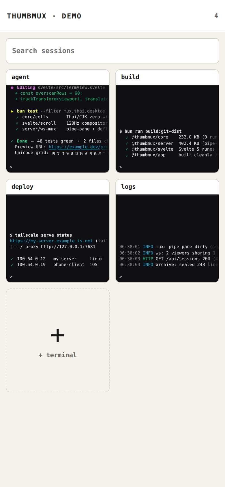
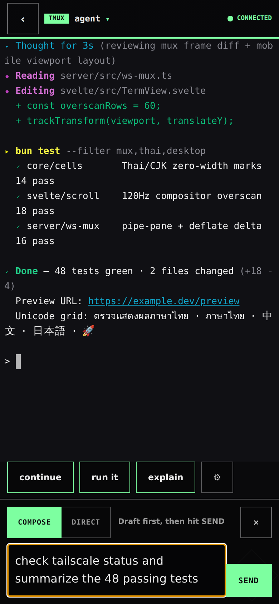
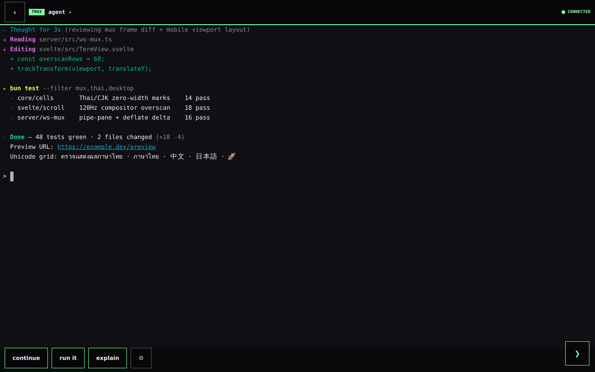

# thumbmux

**thumbmux — the tmux manager for your server.** Run and watch AI agents and long jobs from your phone or browser — smooth 120Hz scrolling, keyboard-aware mobile compose, and zero lost scrollback.

> จัดการ `tmux` บนเซิร์ฟเวอร์จากมือถือหรือเบราว์เซอร์ — สั่งงานและติดตาม AI agent ได้ลื่นเหมือนอยู่หน้าเครื่อง

**v0.23.2** · **MIT** · **Bun + Svelte 5 + TypeScript** · **0 runtime deps in `thumbmux/core`**

---

<p align="center">
  
  &nbsp;&nbsp;
  
</p>

<p align="center">
  
</p>

## Why thumbmux

- **Stay in flow from your phone** — A 120Hz compositor-scroll viewer (`60`-row overscan per side) and keyboard-aware `ComposerDock` (`COMPOSE` draft editor + `DIRECT` raw keys) let you review diffs, tap links, and send prompts cleanly on a 390px screen. Send-once submission never silently retries, and `v0.23.2` names the exact failure code (`network`, `http_<status>`, `in_doubt`, etc.) if delivery fails.
- **Keep AI agents & long jobs alive across drops** — Sessions live inside server `tmux`, so closing your phone or switching networks never interrupts a run. `FileHistoryArchive` retains `20,000` archived lines per session by default (`TermView` keeps `10,000` rows or `8 MiB` in browser RAM), and `v0.23.0` adds opt-in `ownedLifetime` graceful WebSocket drain across restarts.
- **Read agent output without tool-call spam** — Run Claude Code, Codex, `agy`, or any CLI in `tmux`. Built-in `TOOLS` folding (`SHOW` / `HIDE` / `DISTILL` for Claude Code; `SHOW` / `HIDE` for Codex), clickable URLs & OSC 8 hyperlinks, and pane search keep noisy tool blocks tidy.
- **Crisp Thai, CJK & box-drawing layout** — Proper combining-mark cell metrics, wide CJK glyphs, emoji, `U+2500–257F` alignment, and responsive `UI-COMPACT` layouts tuned for both phones and small screens.
- **Private by design over Tailscale** — Binds loopback (`127.0.0.1`) by default with zero public ports. Expose it strictly to your own devices with `tailscale serve` (no Funnel, no extra password over your tailnet), or attach `createTokenGuard()` for LAN access.

## Who it's for

- **Solo devs & server operators** running Claude Code, Codex, `agy`, builds, or migrations on a home server or VPS and checking in from a phone over Tailscale.
- **Tool & dashboard builders** who want embeddable Svelte 5 + Bun components (`thumbmux/app`, `thumbmux/svelte`, `thumbmux/server`, `thumbmux/core`) instead of building a bespoke PTY/tmux streaming layer.

## How it works

<p align="center">
  
</p>

<p align="center">
  <sub>Animated SVG · <a href="docs/assets/stack-flow.png">View static PNG fallback</a></sub>
</p>

1. **Agents & shells run inside `tmux`** — Any CLI (`claude`, `codex`, `agy`, builds, logs) stays persistent on your server regardless of browser state.
2. **Bun server + `TmuxWsMux` fans out one stream to many viewers** — Instead of polling every connected phone or tab independently, `pipe-pane` dirty signals push only changed lines over WebSocket (paired with Bun per-message deflate and slow-client backpressure protection), falling back to adaptive polling (`250 ms` idle / `100 ms` for `5 s` after input) when `pipes` is omitted.
3. **Svelte 5 `TermView` + `ComposerDock` renders at display refresh rate** — GPU-translated viewport rows (`60`-row overscan per side), touch-first selection & compose dock, and multi-session `SessionGrid` previews.
4. **Tailscale keeps the perimeter private** — Proxy localhost cleanly through `tailscale serve` so only your tailnet devices can connect.

### By the numbers (verified on `0.23.2`)

| Metric | Verified value in source |
|---|---|
| **Shipped release** | `0.23.2` (`v0.23.2-dist`) |
| **Core engine (`core/src`)** | `10,605` lines of production TypeScript, **0 runtime dependencies** |
| **Viewport overscan** | `60` rows rendered above & below visible viewport (`TermView`) |
| **Client scrollback retention** | `10,000` rows or `8 MiB` byte budget |
| **Server archive default** | `20,000` lines per session (`FileHistoryArchive.maxLines`) |
| **Fallback poll interval** | `250 ms` idle / `100 ms` for `5 s` after input (no `pipe-pane`) |
| **Slow-client shed defaults** | Drops slow viewer only after `30 s` continuous backpressure or `8 MiB` backlog |

## 60-second start

### Option 1: Try the isolated demo right now

Requires `bun` and `tmux` on macOS or Linux:

```bash
git clone https://github.com/kemkem23/thumbmux
cd thumbmux && bun install
bun run demo            # binds 127.0.0.1 only
bun run demo -- --host  # LAN access protected by one-time URL token
```

### Option 2: Install in your Bun + Svelte 5 app

Pin the newest published prebuilt immutable `-dist` tag (`v0.x.y-dist` contains built `core`, `server`, `svelte`, and `app` outputs with zero lifecycle scripts). Never hardcode a minor glob like `v0.8.*-dist` — list all `refs/tags/v0.*-dist` tags so upgrades keep moving forward:

```bash
THUMBMUX_TAG="$(git ls-remote --tags https://github.com/kemkem23/thumbmux \
  'refs/tags/v0.*-dist' | awk -F/ '{print $3}' | sort -V | tail -n 1)"
if test -z "$THUMBMUX_TAG"; then
  echo "No published v0.x-dist tag found" >&2
else
  bun add "thumbmux@github:kemkem23/thumbmux#${THUMBMUX_TAG}"
  # npm i "github:kemkem23/thumbmux#${THUMBMUX_TAG}"
fi
```

## Quickstart

This minimal pair runs the stock tmux driver, HTTP/WebSocket routes, and full `ThumbmuxApp` UI on loopback `127.0.0.1` (keep it loopback-only unless guarded by Tailscale tailnet identity or `createTokenGuard()`).

**Server (`server.ts`)** — `createAppRoutes()` supplies `GET /api/sessions`, `POST /api/spawn`, `DELETE /api/sessions/:name`, and the `/ws/tmux` WebSocket mux:

<!-- quickstart:server -->
```ts
import { createAppRoutes } from "thumbmux/server";

const routes = createAppRoutes();
const server = Bun.serve({
  hostname: "127.0.0.1",
  port: Number(Bun.env.PORT ?? 3000),
  async fetch(request, bunServer) {
    return await routes.fetch(request, bunServer)
      ?? new Response("Not found", { status: 404 });
  },
  websocket: routes.websocket,
});
console.log(`thumbmux listening on http://127.0.0.1:${server.port}`);
```

**Client (`src/main.ts`)** — Svelte 5 + Vite entry with `<div id="app"></div>`:

<!-- quickstart:client -->
```ts
import { mount } from "svelte";
import { ThumbmuxApp, type AppAdapters } from "thumbmux/app";

const target = document.getElementById("app");
if (!target) throw new Error("Missing #app");

const adapters: AppAdapters = {};
mount(ThumbmuxApp, { target, props: { adapters } });
```

Expose your loopback listener privately to your phone and laptop over Tailscale (never `--funnel`):

```bash
tailscale serve --bg http://127.0.0.1:3000
```

See [docs/app.md](docs/app.md) before adding authentication wrappers, image paste uploads, server preferences, or custom host adapters.

## Security & FAQ

- **Why Tailscale-only?** Terminal access equals shell access. Binding `127.0.0.1` and serving via `tailscale serve` (without Funnel or public port forwards) lets WireGuard device identity protect the socket — no extra login password needed over your private tailnet. If you expose directly on a LAN or reverse proxy, wrap routes with `createTokenGuard()` (see the demo for a working pattern).
- **Is `POST /api/spawn` safe to expose?** `createSpawnHandler` can start caller-supplied shell commands inside `tmux`. Always guard it behind tailnet isolation or interactive auth and restrict working directories with `validateCwd`.
- **Which AI agent CLIs work?** Any TUI or CLI works inside `tmux` (`agy`, `claude`, `codex`, builds, repls). Tool-call folding (`SHOW` / `HIDE` / `DISTILL`) recognizes Claude Code and Codex output directly.
- **How do updates work?** Consumers pin immutable `v0.x.y-dist` tags (prebuilt `dist/` outputs committed on the tag). Hosts can safely automate updates between `-dist` tags by verifying HTTP health and rolling back the pinned ref + lockfile if health checks fail.

## Developer Reference

### Lower-level building blocks

Every public layer can also be imported directly below `ThumbmuxApp`:

```ts
import {
  TmuxWsMux,
  createBunTmuxDriver,
  createSpawnHandler,
  createUploadHandler,
  createPrefsHandler,
  FrameJournal,
  createTokenGuard,
} from 'thumbmux/server';
import {
  defaultSurface,
  buildLaunchCommand,
  submitPlan,
  searchLines,
  parseReplayJournal,
  normalizeAgentNotificationEvent,
} from 'thumbmux/core';
```

```svelte
<script>
  import {
    TermView,
    DesktopKeys,
    ComposerDock,
    SessionGrid,
    TermSearch,
    RecordingPlayer,
    NotificationPermission,
    tmuxMux,
  } from 'thumbmux/svelte';
</script>
```

**TypeScript consumers of `thumbmux/svelte` and `thumbmux/app` must set `"moduleResolution": "bundler"`** (or an equivalent resolver that resolves `./TermView.svelte` to its adjacent `.d.ts`). Under `moduleResolution` `node16` / `nodenext`, the published Svelte declarations fail with TS2307 on sibling `.svelte` imports (`thumbmux/server` and `thumbmux/core` stay clean under both).

### Opt-in dense session chrome

`TermHud` supports `layout="dense"` and `SessionGrid` supports `cardLayout="dense"` (alongside `SessionThumb density="dense"`) for hosts displaying dense operator notes/summaries without losing the stock layout by default. See [docs/hub.md](docs/hub.md) and [docs/app.md](docs/app.md).

## Wiring

Attach `FileHistoryArchive`, optional `pipe-pane` dirty signals, and per-message compression to a single shared `TmuxWsMux`:

```ts
import { FileHistoryArchive, TmuxWsMux } from 'thumbmux/server';

const archive = new FileHistoryArchive({
  root: '.thumbmux-history', // omit for a private per-run temp directory
  maxLines: 20_000,
});

const mux = new TmuxWsMux({
  driver,                     // capture/keys/resize/activity against your tmux
  pipes,                      // optional: pipe-pane manager -> instant dirty signals
  archive,                    // optional: scrollback archive -> history expansion
  compressFrames: true,       // optional: Bun per-message deflate
  profile: (session) => ({
    resize: true,
    currentPaneOnly: false,
    archive: true,
  }),
  hooks: {
    onResizeRequest: (session, ws, geo, client) => ({ apply: true }),
  },
});

ws.onmessage = (e) => mux.handleMessage(JSON.parse(e.data), ws);
ws.onclose  = () => mux.unsubscribeAll(ws);
```

Without `pipes`, live updates fall back to adaptive polling (`250 ms` idle / `100 ms` for `5 s` after input). Without `archive`, live viewing works normally and older history expansion returns an empty page. Forward Bun's `drain(ws)` callback via `mux.onDrain(ws)` when enabling backpressure scheduling.

### Spawn endpoint (`createSpawnHandler`)

`LaunchSheet` emits a `LaunchSpec` via `onLaunch(spec, contextId)` without hardcoding transport policy:

```ts
import type { LaunchSpec } from 'thumbmux/core';

async function launch(spec: LaunchSpec, contextId: string | null) {
  const response = await fetch('/api/spawn', {
    method: 'POST',
    headers: { 'content-type': 'application/json' },
    body: JSON.stringify({
      ...spec,
      cwd: workspaceFor(contextId),
    }),
  });
  const result = await response.json();
  if (!response.ok) throw new Error(result.error);
  return result as { ok: true; name: string };
}
```

The JSON contract accepted by `createSpawnHandler`:

```ts
type SpawnPayload = {
  presetId?: string;
  agent?: string;
  worktree?: boolean; // true requires host prepareWorktree + cleanupWorktree hooks
  permission?: string;
  model?: string;
  command?: string;
  name?: string;
  cwd?: string;
  autoName?: boolean;
};
```

```ts
import { createBunTmuxDriver, createSpawnHandler } from 'thumbmux/server';

const driver = createBunTmuxDriver();
const handleSpawn = createSpawnHandler({
  driver,
  cwd: process.cwd(),
  namePrefix: 'term',
  validateCwd: (cwd) => cwd.startsWith('/srv/workspaces/')
    || 'cwd is outside the workspace root',
  prepareWorktree: ({ name, cwd }) => createIsolatedCheckout({ name, cwd }),
  cleanupWorktree: ({ worktreeCwd }) => removeIsolatedCheckout(worktreeCwd),
});

if (url.pathname === '/api/spawn' && req.method === 'POST') {
  return handleSpawn(req);
}
```

Successful spawns return `201 { ok: true, name }`; duplicate exact names return `409`; invalid payloads, blocked `cwd` paths, or `worktree: true` without both hooks return `400`.

## Host CSS custom properties (theming surface)

Shipped Svelte components read host-supplied CSS custom properties mapped from `TerminalSurface` (`deriveSurface` / `defaultSurface` in `thumbmux/core`):

| Property | Required? | Purpose |
|---|---|---|
| `--font-mono` | **yes** | Primary terminal font stack. `TermView` measures character width from the **computed** font to calculate columns/rows; cover box-drawing `U+2500–257F` and Thai/CJK glyphs consistently (see [docs/desktop.md](docs/desktop.md)). |
| `--font-thai` | optional | Chrome UI mixing Thai (composer, prompts, shortcuts); falls back to `--font-mono`. |
| `--tbg` | **yes** | Terminal surface background. |
| `--tfg` | **yes** | Primary terminal text color. |
| `--tstage` | recommended | Outer stage backdrop behind HUD and dock. |
| `--agent` | recommended | Accent color for borders, LEDs, focus ring. |
| `--hud` | recommended | HUD bar background. |
| `--hud-fg` | recommended | HUD foreground text / icons. |
| `--hud-line` | recommended | HUD hairlines and control borders. |
| `--dock-inset` / `--dock-full` | optional | Mobile `ComposerDock` layout insets. |
| `--kb-inset` | optional | Extra bottom inset while software keyboard is open. |

`SessionView` and `EmbedView` in `thumbmux/app` apply surface variables automatically; mounting `TermView` standalone requires setting `--font-mono`, `--tbg`, and `--tfg` on an ancestor.

## Compatibility & release notes

Public API stability follows [CONTRACT.md](CONTRACT.md). In a source checkout:

```bash
bun run build:git-dist
bun scripts/materialize-contract-baseline.ts /tmp/thumbmux-baseline
THUMBMUX_CONTRACT_BASELINE_ROOT=/tmp/thumbmux-baseline bun run contract
```

<details>
<summary>Release highlights: v0.7.0 → v0.23.2 (click to expand)</summary>

- **v0.23.2**: Compose SEND failure banner surfaces the exact failure code (`network`, `http_<status>`, `unexpected_response`, `in_doubt`, etc.) instead of generic errors, without echoing draft text.
- **v0.23.1**: Deterministic crash-reopen diagnostics and final-frame mutation controls for durable storage tests.
- **v0.23.0**: Opt-in `ownedLifetime: true` on `TmuxWsMux` + `quiesceAndDrain()` and `getOwnedTaskInventory()` for deterministic shutdown cleanup; portable package-local Playwright resolution.
- **v0.22.0**: Send-once semantic COMPOSE via `SubmissionReceipt` & structured `PromptEntry` sections; opt-in NEWARCH v2 protocol & projection types (`thumbmux/pipe-history-runtime`, flag off by default).
- **v0.20.x**: `UI-COMPACT` responsive layouts (`ActionFab`, dense `TermHud` & `SessionGrid`, compact `ComposerDock`), async `createBunTmuxDriver` activity poll, schema-5 durable projection archive & HP7 coalesced checkpoint recovery.
- **v0.8.0 – v0.19.x**: Assembled `thumbmux/app` shell & `createAppRoutes()`, `FileHistoryArchive`, `createSpawnHandler`, `createTokenGuard`, `TOOLS` call folding (`SHOW`/`HIDE`/`DISTILL`), Thai/CJK cell fidelity, searchable terminal buffer, and OSC 8 hyperlinks.

</details>

<details>
<summary>Docs & iOS Safari notes (click to expand)</summary>

- **Application shell guide**: [docs/app.md](docs/app.md)
- **Multi-session hub guide**: [docs/hub.md](docs/hub.md)
- **Desktop keys & font metrics contract**: [docs/desktop.md](docs/desktop.md)
- **Full changelog**: [CHANGELOG.md](CHANGELOG.md)
- **Contract policy & release split**: [CONTRACT.md](CONTRACT.md) · [SPLIT.md](SPLIT.md)
- **iOS Safari layout model**: Uses `100dvh` fixed stage with `overflow: clip`, `visualViewport` keyboard offset tracking (`--kb-inset`), explicit `touch-action` zones, and opaque HUD header so lines never slide under browser chrome.

</details>

## License

[MIT](LICENSE)
