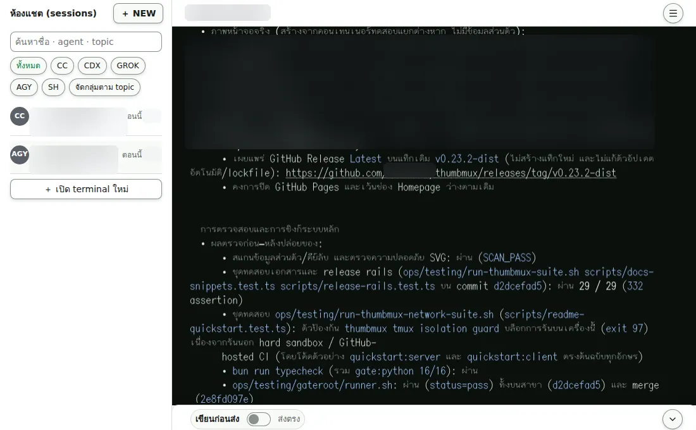
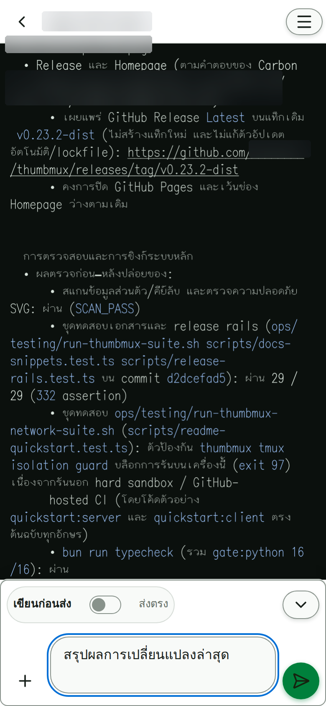
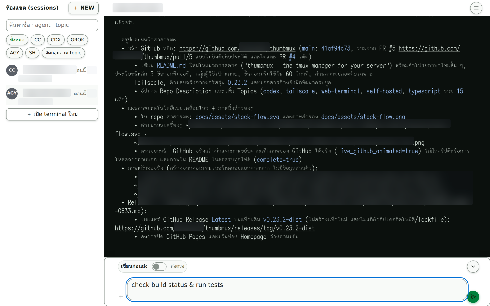
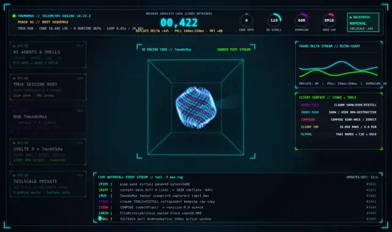

# thumbmux

**thumbmux — the tmux manager for your server.** Run, watch, and steer AI agents (`claude`, `codex`, `agy`, shells) and long-running jobs from your phone or browser — smooth 120Hz scrolling, keyboard-aware compose, and durable scrollback locked inside your private Tailscale mesh.

> จัดการ `tmux` บนเซิร์ฟเวอร์จากมือถือหรือเบราว์เซอร์ — สั่งงาน ดูผล และพับบันทึก tool ของ AI agent ได้ลื่นเหมือนนั่งหน้าเครื่อง

**`v0.23.2`** · **MIT** · **Bun + Svelte 5 + TypeScript** · **`thumbmux/core`: 10,605 LOC, 0 runtime deps**

---

## Real UI in production

Live read-only capture from our running server UI (**frosted blur covers private session names, paths, hosts, and tokens — nothing faked**):

<p align="center">
  
</p>

<p align="center">
  
  &nbsp;&nbsp;
  
</p>

<p align="center">
  <sub>Captured directly from the live production server at <code>390px</code> mobile and <code>1280px</code> desktop; Gaussian blur masks private hostnames, file paths, and session IDs while preserving genuine terminal output.</sub>
</p>

## Why run your agents through thumbmux

- **Walk away from your desk without losing context** — Your jobs and AI agents run inside server `tmux`. Reconnect from cellular or Wi-Fi anytime: `FileHistoryArchive` retains `20,000` archived lines per session by default (`TermView` holds `10,000` rows or `8 MiB` in the browser), and `v0.23.0` adds opt-in `ownedLifetime` graceful WebSocket quiesce and drain across restarts.
- **Built for one-handed phone control, not pinch-zoomed desktop panes** — A 120Hz `translate3d` compositor viewer (`60`-row overscan per side) pairs with a keyboard-aware `ComposerDock` (`COMPOSE` draft editor + `DIRECT` raw key mode). Since `v0.22.0`, compose delivery sends strictly once (`SubmissionReceipt`) without silent retries, and `v0.23.2` names the exact failure code (`network`, `http_<status>`, `in_doubt`, etc.) if delivery fails.
- **Collapse noisy agent tool calls on a 6-inch screen** — Run Claude Code, Codex, `agy`, or any CLI in `tmux`. Built-in `TOOLS` folding (`SHOW` / `HIDE` / `DISTILL` for Claude Code; `SHOW` / `HIDE` for Codex) keeps terminal transcripts clean while preserving clickable OSC 8 / URL links, raw copy, and in-pane search.
- **Readable Thai, CJK, emoji & box-drawing geometry** — Correct Thai combining-mark cell metrics, wide CJK glyphs, `U+2500–257F` line alignment, and `UI-COMPACT` responsive chrome tuned for phones and short laptop viewports.
- **Private by default over Tailscale** — Binds loopback (`127.0.0.1`) with zero public ports. Expose privately to your own devices via `tailscale serve` (no Tailscale Funnel, no extra tailnet login wall), or wrap routes with `createTokenGuard()` when sharing over a LAN.

## Inside the engine

<p align="center">
  
</p>

<p align="center">
  <sub>Self-contained CSS + SMIL animated SVG (no scripts, no external fetches) · <a href="docs/assets/stack-flow.png">Static PNG fallback</a> · <a href="docs/assets/hero-stack.mp4">Watch full 1280×760 30fps MP4</a></sub>
</p>

<p align="center">
  
</p>

1. **Agents & shells stay alive inside `tmux`** — Interactive CLIs (`claude`, `codex`, `agy`, `sh`, builds, monitors) attach to persistent `tmux` panes addressed explicitly (`=session:0.0`).
2. **One `TmuxWsMux` fans out one capture to every connected browser** — `pipe-pane` dirty triggers push changed lines over WebSocket with optional Bun per-message deflate and slow-viewer backpressure protection (dropping backlogged sockets after `30 s` / `8 MiB`). Without `pipes`, adaptive polling steps down automatically (`250 ms` idle / `100 ms` for `5 s` after input).
3. **Svelte 5 `TermView` + `ComposerDock` paints smoothly at refresh rate** — GPU-translated viewport rows (`60`-row overscan per side), `TOOLS` call folding (`SHOW` / `HIDE` / `DISTILL`), and a bidirectional magenta input control loop (`COMPOSE` / `DIRECT` → `submitPlan()` → `tmux`).
4. **Tailscale closes the perimeter** — Loopback binding on the server paired with `tailscale serve` restricts access cleanly to devices on your tailnet.

### Verified numbers on `0.23.2`

| Surface | Measured fact in source |
|---|---|
| **Shipped release** | `0.23.2` (`v0.23.2-dist`) |
| **Core engine (`core/src`)** | `10,605` lines of production TypeScript, **0 runtime dependencies** |
| **Viewport overscan** | `60` rows rendered above & below visible viewport (`TermView`) |
| **Client scrollback budget** | `10,000` rows or `8 MiB` byte limit |
| **Server history archive** | `20,000` lines per session default (`FileHistoryArchive.maxLines`) |
| **Fallback poll interval** | `250 ms` idle / `100 ms` for `5 s` after input (when `pipe-pane` is off) |
| **Backpressure shed guard** | `30 s` continuous backpressure or `8 MiB` queue depth |

## Who uses thumbmux

- **Engineers running overnight AI agents & builds** who want to check progress, collapse tool noise, inspect diffs, and send next steps from iOS/Android over Tailscale.
- **Tool & orchestrator builders** composing `thumbmux/app`, `thumbmux/svelte`, `thumbmux/server`, and `thumbmux/core` directly inside their own Svelte 5 + Bun UI.

## 60-second start

### Try the standalone demo

Requires `bun` and `tmux` on Linux or macOS:

```bash
git clone https://github.com/kemkem23/thumbmux
cd thumbmux && bun install
bun run demo            # binds 127.0.0.1 only
bun run demo -- --host  # LAN access guarded by a one-time URL token
```

### Add the prebuilt package to a Bun + Svelte 5 project

Pin the latest published immutable `-dist` tag (`v0.x.y-dist` bundles prebuilt `core`, `server`, `svelte`, and `app` outputs with zero install scripts). Always query `'refs/tags/v0.*-dist'` rather than hardcoding a minor glob like `v0.8.*-dist`:

```bash
THUMBMUX_TAG="$(git ls-remote --tags https://github.com/kemkem23/thumbmux \
  'refs/tags/v0.*-dist' | awk -F/ '{print $3}' | sort -V | tail -n 1)"
if test -z "$THUMBMUX_TAG"; then
  echo "No published v0.x-dist tag found" >&2
else
  bun add "thumbmux@github:kemkem23/thumbmux#${THUMBMUX_TAG}"
  # npm i "github:kemkem23/thumbmux#${THUMBMUX_TAG}"
fi
```

## Quickstart

This minimal server/client pair wires the stock `tmux` driver, HTTP/WebSocket routes, and `ThumbmuxApp` UI on loopback `127.0.0.1`. Keep it loopback-only unless shielded by Tailscale or `createTokenGuard()`.

**Server (`server.ts`)** — `createAppRoutes()` serves `GET /api/sessions`, `POST /api/spawn`, `DELETE /api/sessions/:name`, and `/ws/tmux`:

<!-- quickstart:server -->
```ts
import { createAppRoutes } from "thumbmux/server";

const routes = createAppRoutes();
const server = Bun.serve({
  hostname: "127.0.0.1",
  port: Number(Bun.env.PORT ?? 3000),
  async fetch(request, bunServer) {
    return await routes.fetch(request, bunServer)
      ?? new Response("Not found", { status: 404 });
  },
  websocket: routes.websocket,
});
console.log(`thumbmux listening on http://127.0.0.1:${server.port}`);
```

**Client (`src/main.ts`)** — Svelte 5 + Vite entry with `<div id="app"></div>`:

<!-- quickstart:client -->
```ts
import { mount } from "svelte";
import { ThumbmuxApp, type AppAdapters } from "thumbmux/app";

const target = document.getElementById("app");
if (!target) throw new Error("Missing #app");

const adapters: AppAdapters = {};
mount(ThumbmuxApp, { target, props: { adapters } });
```

Expose privately across your tailnet (never `--funnel`):

```bash
tailscale serve --bg http://127.0.0.1:3000
```

See [docs/app.md](docs/app.md) before adding custom auth guards, image uploads, server preferences, or host panels.

## Security & FAQ

- **How does Tailscale security work here?** Your server binds only `127.0.0.1`, and `tailscale serve` terminates TLS exclusively for authenticated nodes on your tailnet (no public internet port, no password database needed on a personal tailnet). For shared LAN or reverse-proxy setups, guard endpoints with `createTokenGuard()`.
- **Is `POST /api/spawn` dangerous if unguarded?** Yes — `createSpawnHandler` runs caller-supplied commands in `tmux`. Protect it behind tailnet isolation or auth and restrict paths with `validateCwd`.
- **Which agents work?** Any TUI or CLI in `tmux` (`claude`, `codex`, `agy`, shells, `htop`, `vim`). Built-in `TOOLS` folding supports Claude Code (`SHOW` / `HIDE` / `DISTILL`) and Codex (`SHOW` / `HIDE`).
- **How are upgrades kept safe?** Every release publishes an immutable `v0.x.y-dist` tag containing compiled artifacts, allowing deterministic pinning and clean HTTP-health rollback between releases.

## Developer Reference

### Lower-level building blocks

All four package layers are exported individually below `ThumbmuxApp`:

```ts
import {
  TmuxWsMux,
  createBunTmuxDriver,
  createSpawnHandler,
  createUploadHandler,
  createPrefsHandler,
  FrameJournal,
  createTokenGuard,
} from 'thumbmux/server';
import {
  defaultSurface,
  buildLaunchCommand,
  submitPlan,
  searchLines,
  parseReplayJournal,
  normalizeAgentNotificationEvent,
} from 'thumbmux/core';
```

```svelte
<script>
  import {
    TermView,
    DesktopKeys,
    ComposerDock,
    SessionGrid,
    TermSearch,
    RecordingPlayer,
    NotificationPermission,
    tmuxMux,
  } from 'thumbmux/svelte';
</script>
```

**TypeScript consumers of `thumbmux/svelte` and `thumbmux/app` must set `"moduleResolution": "bundler"`** (or an equivalent resolver that resolves `./TermView.svelte` to its adjacent `.d.ts`). Under `moduleResolution` `node16` / `nodenext`, published Svelte declarations fail with TS2307 on sibling `.svelte` imports (`thumbmux/server` and `thumbmux/core` stay clean under both).

### Opt-in dense session chrome

`TermHud` accepts `layout="dense"`, `SessionGrid` accepts `cardLayout="dense"`, and `SessionThumb` accepts `density="dense"` for compact metadata bars (`hubPresentation.cardLayout` / `sessionPresentation.headerLayout` on `ThumbmuxApp`). See [docs/hub.md](docs/hub.md) and [docs/app.md](docs/app.md).

## Wiring

Attach `FileHistoryArchive`, optional `pipe-pane` triggers, and per-message compression to a shared `TmuxWsMux`:

```ts
import { FileHistoryArchive, TmuxWsMux } from 'thumbmux/server';

const archive = new FileHistoryArchive({
  root: '.thumbmux-history', // omit for a private per-run temp directory
  maxLines: 20_000,
});

const mux = new TmuxWsMux({
  driver,                     // capture/keys/resize/activity against your tmux
  pipes,                      // optional: pipe-pane manager -> instant dirty signals
  archive,                    // optional: scrollback archive -> history expansion
  compressFrames: true,       // optional: Bun per-message deflate
  profile: (session) => ({
    resize: true,
    currentPaneOnly: false,
    archive: true,
  }),
  hooks: {
    onResizeRequest: (session, ws, geo, client) => ({ apply: true }),
  },
});

ws.onmessage = (e) => mux.handleMessage(JSON.parse(e.data), ws);
ws.onclose  = () => mux.unsubscribeAll(ws);
```

Without `pipes`, updates fall back cleanly to adaptive polling (`250 ms` idle / `100 ms` for `5 s` after input). Forward Bun's `drain(ws)` hook via `mux.onDrain(ws)` when enabling slow-client backpressure scheduling.

### Spawn endpoint (`createSpawnHandler`)

`LaunchSheet` emits a `LaunchSpec` via `onLaunch(spec, contextId)`:

```ts
import type { LaunchSpec } from 'thumbmux/core';

async function launch(spec: LaunchSpec, contextId: string | null) {
  const response = await fetch('/api/spawn', {
    method: 'POST',
    headers: { 'content-type': 'application/json' },
    body: JSON.stringify({
      ...spec,
      cwd: workspaceFor(contextId),
    }),
  });
  const result = await response.json();
  if (!response.ok) throw new Error(result.error);
  return result as { ok: true; name: string };
}
```

Accepted payload contract:

```ts
type SpawnPayload = {
  presetId?: string;
  agent?: string;
  worktree?: boolean; // true requires host prepareWorktree + cleanupWorktree hooks
  permission?: string;
  model?: string;
  command?: string;
  name?: string;
  cwd?: string;
  autoName?: boolean;
};
```

```ts
import { createBunTmuxDriver, createSpawnHandler } from 'thumbmux/server';

const driver = createBunTmuxDriver();
const handleSpawn = createSpawnHandler({
  driver,
  cwd: process.cwd(),
  namePrefix: 'term',
  validateCwd: (cwd) => cwd.startsWith('/srv/workspaces/')
    || 'cwd is outside the workspace root',
  prepareWorktree: ({ name, cwd }) => createIsolatedCheckout({ name, cwd }),
  cleanupWorktree: ({ worktreeCwd }) => removeIsolatedCheckout(worktreeCwd),
});

if (url.pathname === '/api/spawn' && req.method === 'POST') {
  return handleSpawn(req);
}
```

Successful spawns return `201 { ok: true, name }`; exact-name collisions return `409`; invalid payloads, blocked `cwd`, or `worktree: true` without both hooks return `400`.

## Host CSS custom properties (theming surface)

Svelte components read host-supplied CSS custom properties mapped from `TerminalSurface` (`deriveSurface` / `defaultSurface` in `thumbmux/core`):

| Property | Required? | Purpose |
|---|---|---|
| `--font-mono` | **yes** | Primary terminal font stack. `TermView` measures character width from computed styles; cover box-drawing `U+2500–257F` and Thai/CJK glyphs consistently (see [docs/desktop.md](docs/desktop.md)). |
| `--font-thai` | optional | Chrome UI mixing Thai (composer, prompts, shortcuts); falls back to `--font-mono`. |
| `--tbg` | **yes** | Terminal surface background. |
| `--tfg` | **yes** | Primary terminal text color. |
| `--tstage` | recommended | Outer stage backdrop behind HUD and dock. |
| `--agent` | recommended | Accent color for borders, focus rings, LEDs. |
| `--hud` | recommended | HUD bar background. |
| `--hud-fg` | recommended | HUD foreground text and icons. |
| `--hud-line` | recommended | HUD hairlines and control borders. |
| `--dock-inset` / `--dock-full` | optional | Mobile `ComposerDock` layout insets. |
| `--kb-inset` | optional | Extra bottom inset while a software keyboard is open. |

`SessionView` and `EmbedView` apply surface variables automatically; mounting `TermView` standalone requires setting `--font-mono`, `--tbg`, and `--tfg` on an ancestor.

## Compatibility & release history

API stability follows [CONTRACT.md](CONTRACT.md). In a source checkout:

```bash
bun run build:git-dist
bun scripts/materialize-contract-baseline.ts /tmp/thumbmux-baseline
THUMBMUX_CONTRACT_BASELINE_ROOT=/tmp/thumbmux-baseline bun run contract
```

<details>
<summary>Release highlights: v0.7.0 → v0.23.2 (click to expand)</summary>

- **v0.23.2**: Compose SEND failure notice names the exact failure code (`network`, `http_<status>`, `unexpected_response`, `in_doubt`, admission codes) without echoing typed drafts.
- **v0.23.1**: Deterministic crash-reopen diagnostics and final-frame mutation controls for storage verification.
- **v0.23.0**: Opt-in `ownedLifetime: true` on `TmuxWsMux` + `quiesceAndDrain()` & `getOwnedTaskInventory()` for clean host shutdown drain; portable package-local Playwright resolution.
- **v0.22.0 / v0.21.0**: Send-once semantic `COMPOSE` via `SubmissionReceipt` & structured `PromptEntry` sections; opt-in NEWARCH v2 protocol & projection surface (`thumbmux/pipe-history-runtime`, flag off by default).
- **v0.20.x**: `UI-COMPACT` responsive layouts (`ActionFab`, dense `TermHud` / `SessionGrid`, single-row compact `ComposerDock`), async `createBunTmuxDriver` activity poll, schema-5 archive & coalesced recovery.
- **v0.8.0 – v0.19.x**: Assembled `thumbmux/app` shell & `createAppRoutes()`, `FileHistoryArchive`, `createSpawnHandler()`, `createTokenGuard()`, `TOOLS` call folding (`SHOW`/`HIDE`/`DISTILL`), Thai/CJK cell accuracy, pane search, and OSC 8 links.

</details>

<details>
<summary>Docs map & iOS Safari notes (click to expand)</summary>

- **Application shell**: [docs/app.md](docs/app.md)
- **Multi-session hub**: [docs/hub.md](docs/hub.md)
- **Desktop keys & font metrics**: [docs/desktop.md](docs/desktop.md)
- **Changelog · Contract · Split release**: [CHANGELOG.md](CHANGELOG.md) · [CONTRACT.md](CONTRACT.md) · [SPLIT.md](SPLIT.md)
- **iOS Safari geometry**: Fixed `100dvh` stage with `overflow: clip`, `visualViewport` keyboard offset (`--kb-inset`), explicit `touch-action` zones, and opaque top HUD bar.

</details>

## License

[MIT](LICENSE)
